# 📚 Library Management System

The **Library Management System (LMS)** is developed to transform manual library operations into an automated online system. It provides essential features for managing students, books, categories, and publications efficiently.

✨ **Key Features:**
- 👨‍💼 Admin and Student modules with separate functionalities.
- 📖 Add, manage, and maintain book records.
- 👨‍🎓 Student registration and account management.
- 🔐 Login authentication and basic verification-code checks.
- 📚 Book issuing, returning, and request management.
- 💰 Fine calculation and overdue book management.
- 📊 Generate user-wise and overdue reports.
- 👤 Profile management and password updates.

---

# 🚀 Getting Started

Follow these instructions to set up and run the project on your local machine for development and testing.

## 🛠️ Prerequisites

Basic knowledge of the following technologies is helpful:

- 🌐 HTML
- 🎨 CSS
- ⚙️ PHP
- 🗄️ MySQL

**XAMPP Server** is used to provide the Apache web server and MySQL database environment.

📥 Download and install XAMPP from:

https://www.apachefriends.org/download.html

## ⚙️ Setting Up the Environment

Follow these steps to run the project:

1. 📦 Download and extract the project source code on your local machine.
2. 📁 Rename the extracted folder to `lms`.
3. 📂 Move the `lms` folder into the XAMPP `htdocs` directory. The default Windows path is:

   `C:\xampp\htdocs`

4. ▶️ Open the XAMPP Control Panel and start **Apache** and **MySQL** services.
5. 🌐 Open your browser and navigate to:

   `http://localhost/phpmyadmin/`

6. 🗄️ Create a new database named `library`.
7. 📥 Select the `library` database and import the SQL file provided in the repository: `library.sql`.
8. 🔧 Open the configuration files in both `includes` directories and update the database username and password according to your local setup.
9. 🚀 Open your browser and navigate to:

   `http://localhost/lms/`

10. 🔑 Use the following default demonstration credentials to access the admin panel:

   - **Username:** `admin`
   - **Password:** `admin`
   - **Verification Code:** `12345`

⚠️ **Note:** These are demonstration credentials and the fixed verification code used in the current implementation. Change the default credentials and improve password security before deploying the application for real-world use.

---

# 📸 Screenshots

Explore the different modules and interfaces of the Library Management System.

### 🔐 Login Page

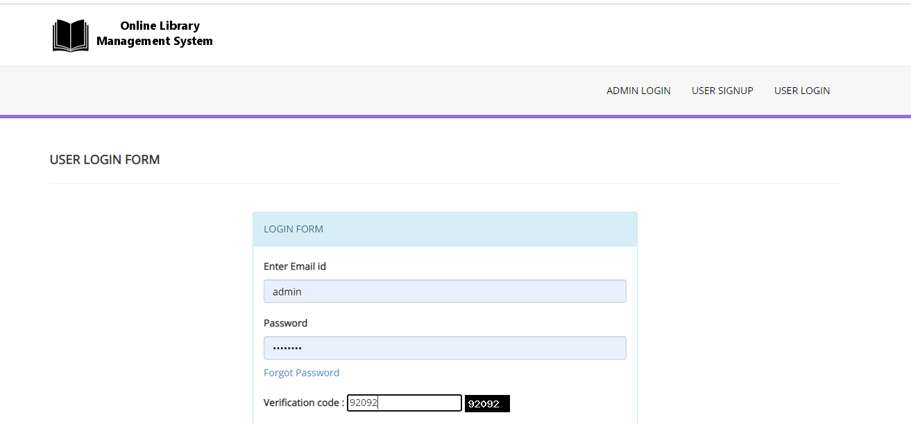

---

### 📊 Admin Dashboard

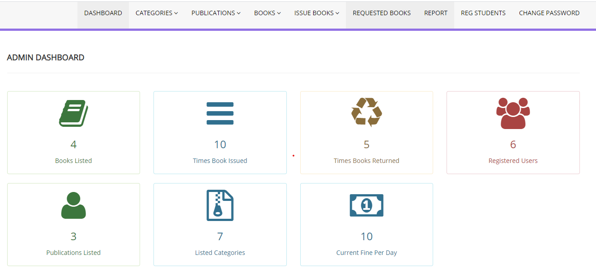

---

### 👤 User Profile

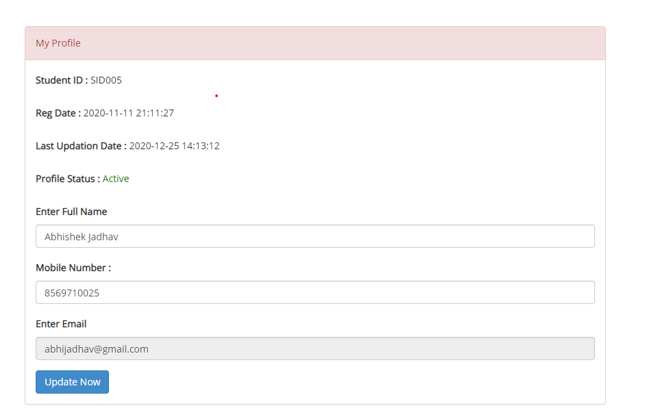

---

### ➕ Add Book

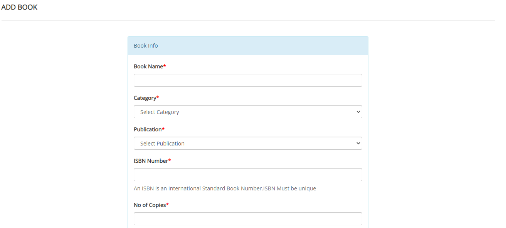

---

### 📚 Manage Books

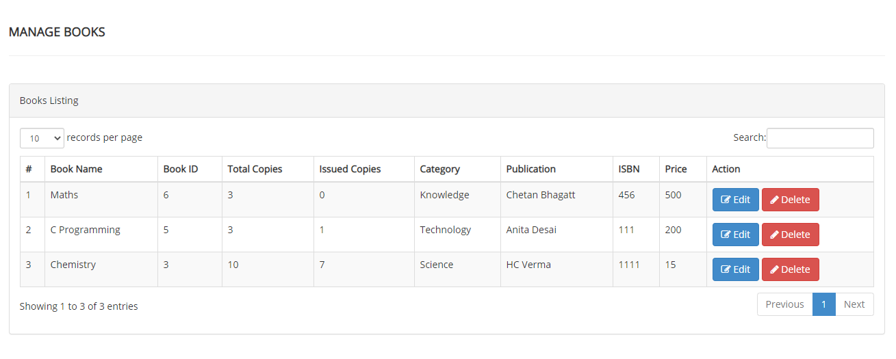

---

### 🏷️ Add Category

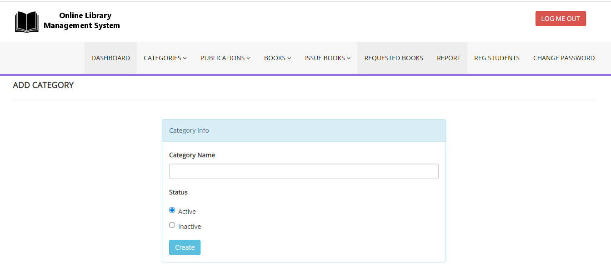

---

### 📋 Manage Categories

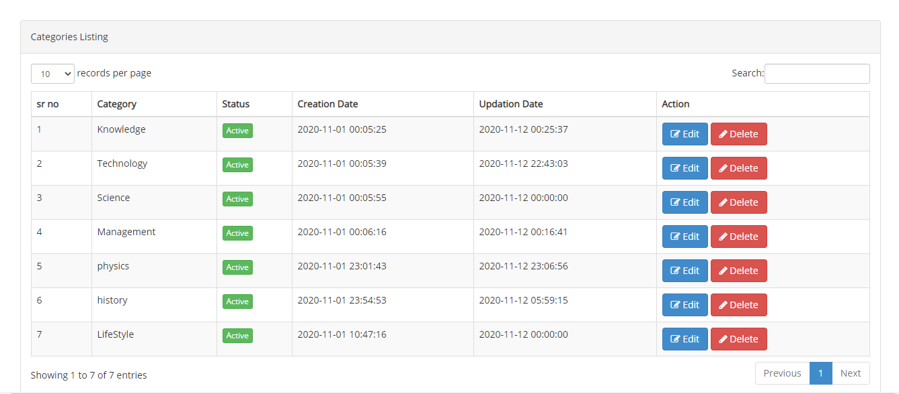

---

### 🏢 Add Publication

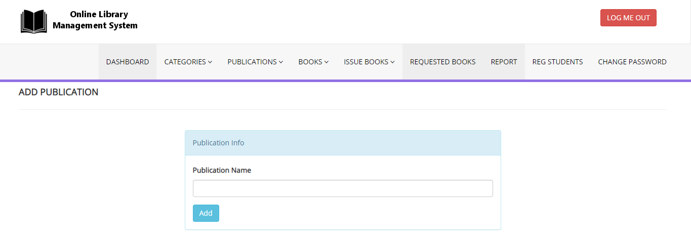

---

### 📖 Manage Publications

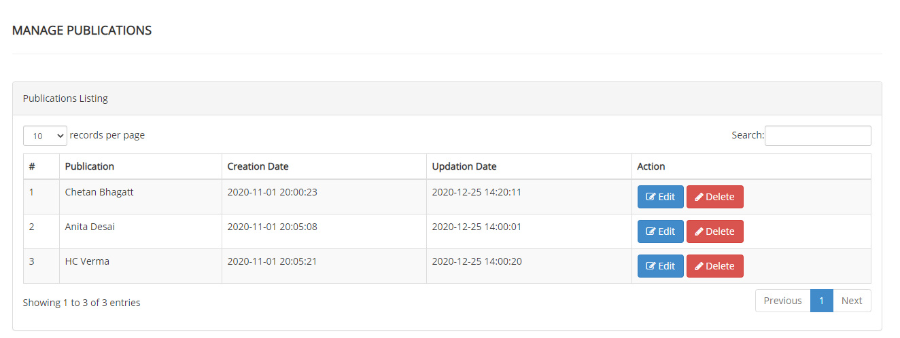

---

### 🔑 Change Password

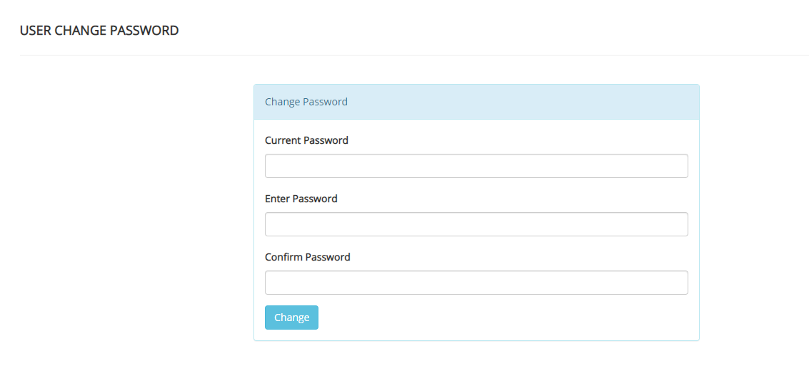

---

### 💰 Set Fine

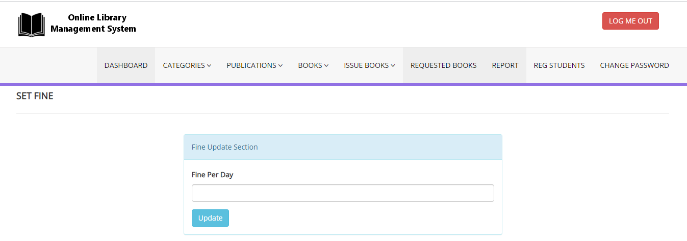

---

### 📕 Issue Book

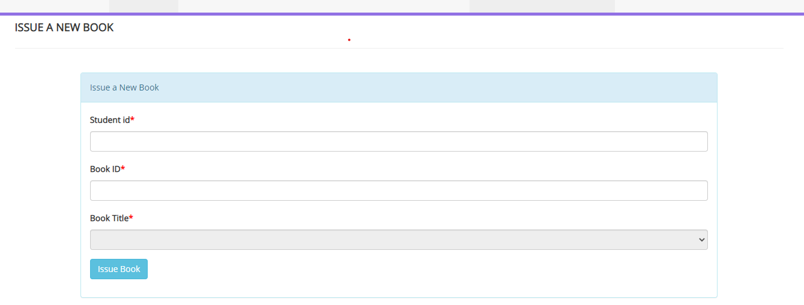

---

### 📚 Manage Issued Books

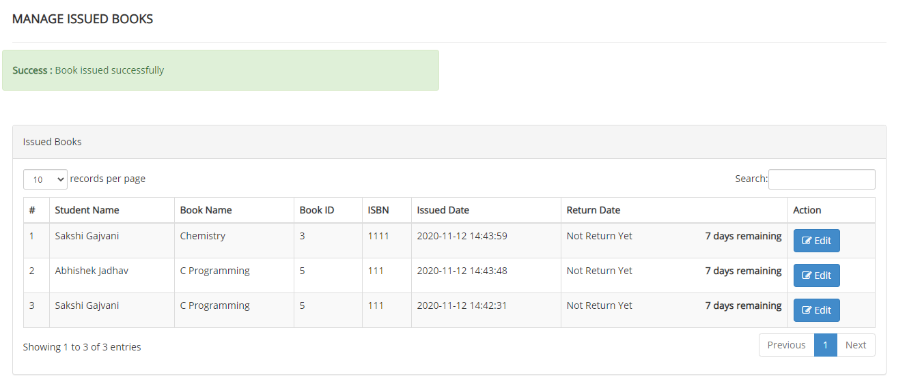

---

### 📚 Manage Issued Books – View 2

---

### 📩 Manage Requested Books

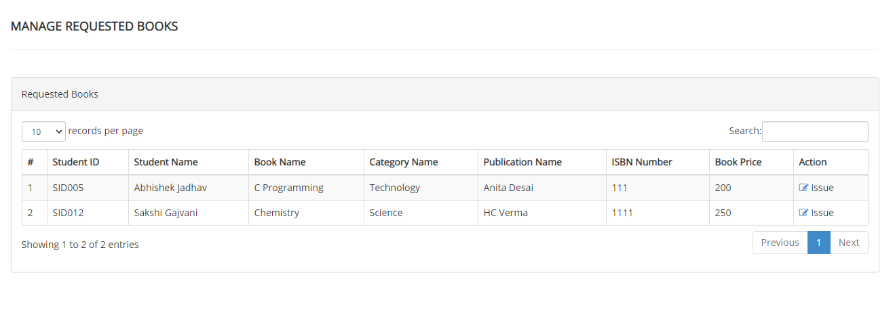

---

### 👨‍🎓 Registered Students

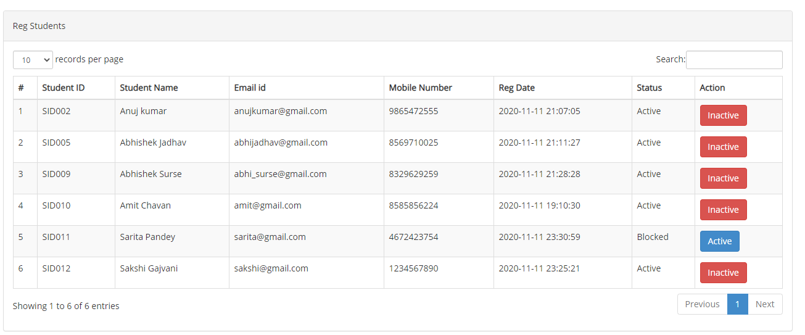

---

### 📊 Reports

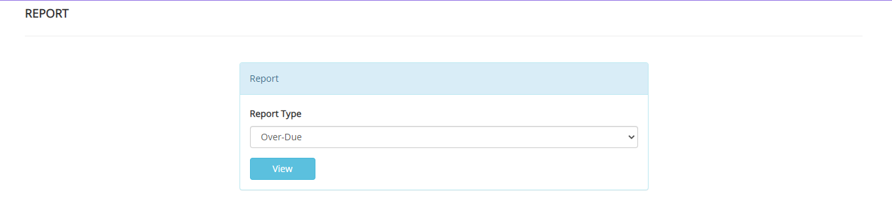

---

### ⏰ Overdue Report

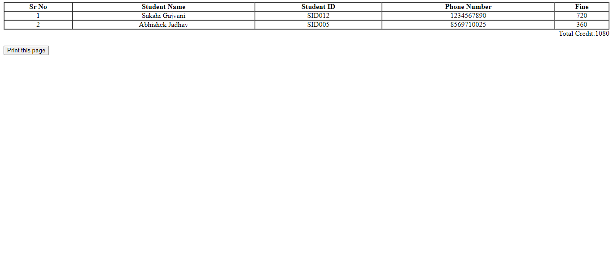

---

### 👥 User-Wise Report

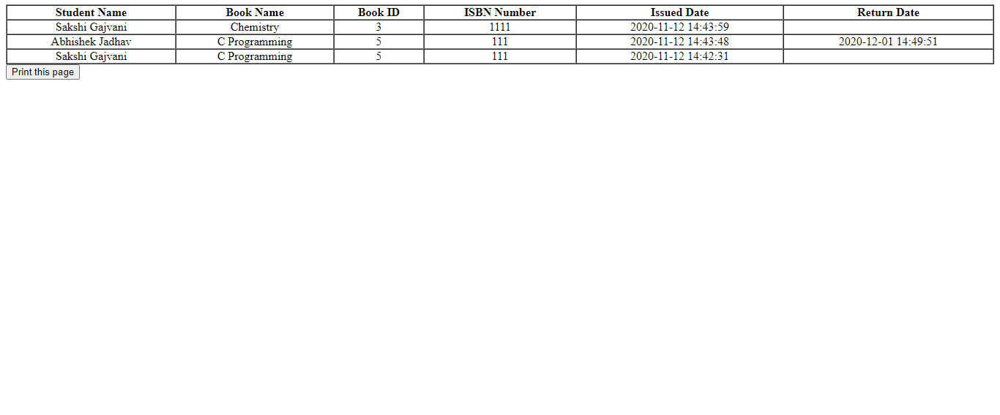

---

